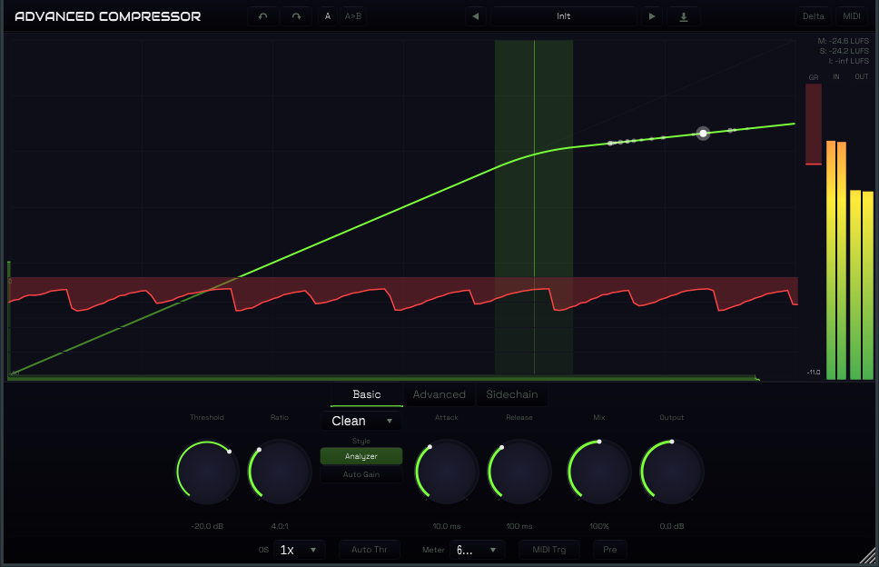

# Advanced Compressor

[](LICENSE)
[](https://github.com/straplocked/advanced-compressor/actions/workflows/ci.yml)

A professional dynamics compressor audio plugin built with [JUCE 7](https://juce.com/). Features 14 compression styles (including upward and combined downward+upward), character saturation (Tube/Diode/Bright), 6-band sidechain EQ, M/S processing, oversampling up to 32x, host-synced rhythmic compression, undo/redo, A/B comparison, delta listen mode, auto threshold, MIDI trigger, and a real-time spectrum analyzer.



## Features

- **14 Compression Styles** -- Clean, Classic, Opto, Vocal, Mastering, Bus, Punch, Pumping, Versatile, Smooth, Op-El, Vari-Mu, Upward, TTM -- each with distinct detection modes, ballistics, and character
- **Character Saturation** -- Tube, Diode, and Bright modes with adjustable Drive (0-24 dB)
- **Soft-Knee Compression** with adjustable knee width (0-72 dB) and range limiting
- **6-Band Sidechain EQ** -- low cut, low shelf, two bell bands, high shelf, high cut with full frequency/gain/slope control
- **External Sidechain** input with audition mode
- **Mid/Side Processing** -- 5 stereo modes: Normal, Mid, Side, M>S, S>M
- **Stereo Link** -- 0-100% continuously variable between dual-mono and linked
- **Lookahead** up to 20 ms with automatic latency compensation
- **Oversampling** -- 1x, 2x, 4x, 8x, 16x, or 32x for reduced aliasing on aggressive settings
- **Auto Threshold** -- slow RMS follower for level-independent compression
- **Auto Gain** makeup compensation
- **Dry/Wet Mix** -- 0-200% range for parallel compression
- **Undo/Redo** with full parameter history
- **A/B Comparison** -- instantly switch between two parameter snapshots
- **Delta Listen** mode -- monitor only the difference between wet and dry
- **MIDI Trigger** -- external MIDI-driven compression triggering
- **Real-Time Spectrum Analyzer** with pre/post display
- **19 Factory Presets** across Vocal, Drums, Bus, Mastering, and Creative categories
- **Input/Output Gain and Pan** controls
- **Hover Help** -- hold your cursor over any control for 1.3 seconds to see a contextual tooltip
- **Host-Synced Rhythmic Compression** -- tempo-synced triggering with square, triangle, sine, and sawtooth shapes
- **Collapsible Sidechain Drawer** -- animated expand/collapse panel for the 6-band SC EQ
- **Pro-C 3 Inspired Layout** -- two-tier control panel with large primary knobs and compact secondary controls, meters on the right

## Compression Styles

| Style | Detection | Topology | Character |
|-------|-----------|----------|-----------|
| **Clean** | Peak | Feedforward | Transparent, program-dependent release |
| **Classic** | RMS | Feedback | Vintage glue, program-dependent release |
| **Opto** | RMS | Feedforward | Two-stage release (LDR model) |
| **Vocal** | Peak+RMS | Feedforward | Adaptive knee/ratio |
| **Mastering** | RMS | Feedforward | Maximum transparency |
| **Bus** | RMS | Feedback | Cohesive glue |
| **Punch** | Peak | Feedforward | Fast, transient-preserving |
| **Pumping** | Peak | Feedforward | Exaggerated envelope |
| **Versatile** | Peak+RMS | Feedforward | Balanced general-purpose |
| **Smooth** | RMS | Feedforward | Super-smooth, large knee |
| **Op-El** | RMS | Feedforward | Gain-dependent attack (warm opto-tube) |
| **Vari-Mu** | RMS | Feedback | Variable ratio with signal level |
| **Upward** | RMS | Feedforward | Boosts signals below threshold |
| **TTM** | RMS | Feedforward | Combined downward + upward compression |

## Character Modes

| Mode | Description |
|------|-------------|
| **Off** | No saturation |
| **Tube** | Asymmetric tanh waveshaper (warm, soft clipping) |
| **Diode** | Symmetric hard clipping with soft knee |
| **Bright** | Chebyshev polynomial adding odd harmonics |

Each mode has an adjustable **Drive** parameter (0-24 dB) with automatic gain compensation and DC blocking.

## Plugin Formats

| Format | Platform |
|--------|----------|
| VST3 | macOS, Windows, Linux |
| AU | macOS |
| CLAP | macOS, Windows, Linux (requires submodule) |
| Standalone | macOS, Windows, Linux |
| AAX | macOS, Windows (requires SDK) |

## Building

### Requirements

- CMake 3.25+
- C++20 compiler (Clang 14+, GCC 12+, MSVC 2022+)
- JUCE 7.0.12 (included as git submodule)

### macOS

```bash
git clone --recurse-submodules https://github.com/straplocked/advanced-compressor.git
cd advanced-compressor
cmake -B build
cmake --build build
```

Builds universal binary (arm64 + x86_64). Plugins are automatically copied to:
- AU: `~/Library/Audio/Plug-Ins/Components/`
- VST3: `~/Library/Audio/Plug-Ins/VST3/`

### Windows

```bash
cmake -B build -G "Visual Studio 17 2022"
cmake --build build --config Release
```

### Linux

```bash
sudo apt-get install libasound2-dev libfreetype6-dev libx11-dev libxrandr-dev libxcursor-dev libxinerama-dev libgl1-mesa-dev libxcomposite-dev
cmake -B build
cmake --build build
```

### CLAP Support

To build with CLAP format, initialize the submodule:

```bash
git submodule update --init libs/clap-juce-extensions
```

### AAX Support

```bash
cmake -B build -DAAX_SDK_PATH=/path/to/aax-sdk
cmake --build build
```

## Project Structure

```
advanced-compressor/
├── CMakeLists.txt                  Build configuration
├── cmake/PlatformDefaults.cmake    Platform compiler flags
├── JUCE/                           JUCE framework (submodule)
├── libs/clap-juce-extensions/      CLAP support (optional submodule)
├── docs/                           Documentation
├── resources/                      Fonts, icons, presets
└── source/
    ├── PluginProcessor.h/cpp       Audio processor entry point
    ├── PluginEditor.h/cpp          GUI editor
    ├── dsp/                        DSP engine
    ├── analyzer/                   FFT spectrum analyzer
    ├── metering/                   Level and GR metering
    ├── midi/                       MIDI learn manager
    ├── parameters/                 Parameter definitions
    ├── presets/                    Preset system
    ├── ui/                        UI components and styling
    │   ├── components/            Panels, knobs, meters, icon buttons
    │   ├── help/                  Hover help overlay and tooltip database
    │   └── LookAndFeel/           Colours, fonts, icons, custom L&F
    └── utils/                     Math utilities and constants
```

## Parameters

51 automatable parameters across 9 groups:

| Group | Parameters |
|-------|-----------|
| **Dynamics** | Threshold, Ratio, Knee, Range, Attack, Release, Hold, Lookahead |
| **Style** | Compression style (12 choices) |
| **Gain/Mix** | Input/Output Gain, Input/Output Pan, Wet Gain, Auto Gain, Mix |
| **Character** | Character Mode (Off/Tube/Diode/Bright), Drive |
| **Sidechain** | External, Audition, Delta, LC Freq/On/Slope, Low Shelf Freq/Gain/On, Band Freq/Gain/Q, Band 2 Freq/Gain/Q, High Shelf Freq/Gain/On, HC Freq/On/Slope |
| **Stereo** | Stereo Link, Stereo Mode |
| **Auto** | Auto Threshold |
| **MIDI/Sync** | MIDI Trigger, Host Sync, Sync Division, Sync Shape |
| **Global** | Analyzer On/Pre, Oversampling, Compact Mode, Meter Scale |

## Tech Stack

- **Framework**: JUCE 7.0.12
- **Language**: C++20
- **Build**: CMake 3.25+
- **DSP**: Cytomic TPT SVF filters, one-pole envelope followers
- **Threading**: Lock-free audio thread via atomic parameters and triple buffers

## Contributing

See [CONTRIBUTING.md](CONTRIBUTING.md) for development setup, code style, and contribution guidelines.

## License

This project is licensed under the [GNU General Public License v3.0 or later](LICENSE).
